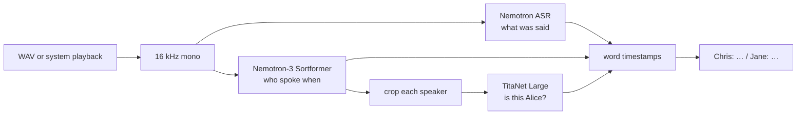
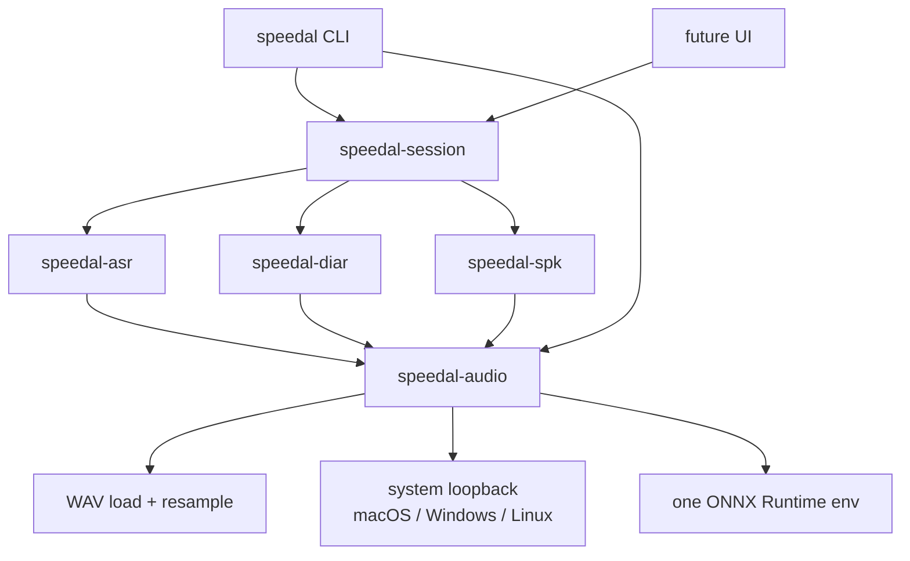
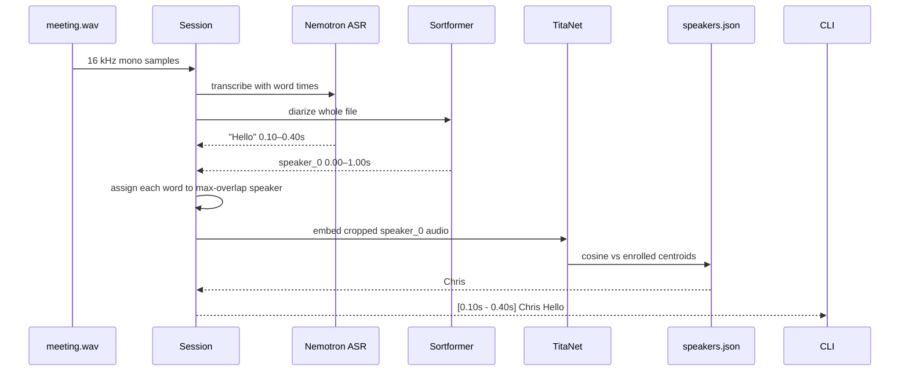
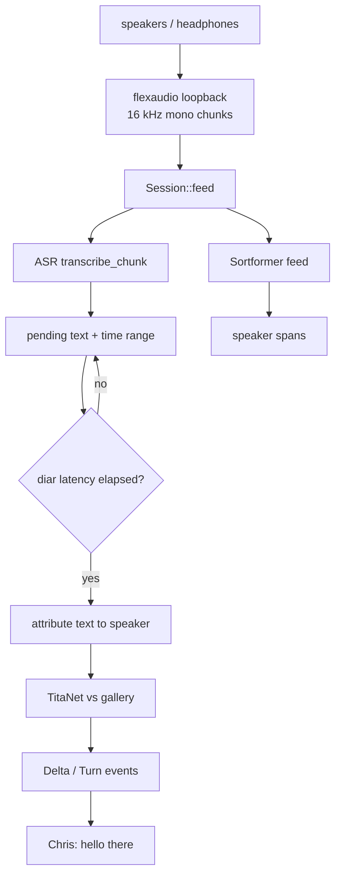

# speedal

[](https://www.rust-lang.org/)
[](https://spdx.org/licenses/MIT.html)
[](https://onnxruntime.ai/)
[](https://huggingface.co/nvidia/Nemotron-3-Diarization)
[](#quick-start)
[](#how-it-works)

Local **who said what** on this computer’s speakers. One 16 kHz stream feeds three NVIDIA models at once: streaming ASR, speaker diarization, and a voice print that survives the next meeting.

```
[  0.56s -   9.60s] Chris  To celebrate the release of Nemotron three diarization…
[  9.60s -  12.00s] Jane   Hi everybody, thanks for having me. I'm Jane.
```

No cloud. First run downloads ONNX weights; after that it is cache + CPU.

## How it works

Diarization alone can only say `speaker_0`. ASR alone can only say the words. A voice-print model alone cannot tell *when* someone talked. speedal runs all three on the **same** mono stream and aligns them.



| Job | Model | Output |
| --- | --- | --- |
| Words | [Nemotron Speech Streaming 0.6B](https://huggingface.co/nvidia/nemotron-speech-streaming-en-0.6b) | Text, ~560 ms encoder chunks, word times on files |
| Turns | [Nemotron-3 Diarization](https://huggingface.co/nvidia/Nemotron-3-Diarization) (Sortformer v3) | `speaker_0…7`, 10 ms resolution, up to 8 people |
| Identity | [TitaNet Large](https://huggingface.co/nvidia/speakerverification_en_titanet_large) ONNX | 192-d embedding, cosine match to a local gallery |

Sortformer IDs are **arrival order in this session**. TitaNet is what makes `speaker_0` become `Chris` tomorrow.

## Architecture

Libraries do the work. The CLI is a thin consumer. A later UI can call the same `Session` without going through clap.



| Crate | Role |
| --- | --- |
| `speedal-audio` | 16 kHz mono WAV, system-playback capture, shared ORT environment |
| `speedal-asr` | Download + run Nemotron streaming ASR |
| `speedal-diar` | Download + run Sortformer |
| `speedal-spk` | TitaNet frontend (80-bin log-mel) + `speakers.json` gallery |
| `speedal-session` | One stream, three models, speaker-attributed events |
| `speedal-cli` | `diar` / `asr` / `both` / `enroll` / `speakers` |

## Runtime flow

### File: `speedal both meeting.wav`

Offline path: full-file diarization + word-level ASR timestamps, then overlap.



### Live: `speedal both --listen`

The same callback that receives a capture chunk feeds **both** streaming models. ASR is faster (~560 ms) than diarization on the `low` profile (~1.04 s), so text is held until speaker labels catch up, then emitted as `Delta` / `Turn` events.



Type this while it is running to name the person who is talking:

```text
enroll Alice
enroll Bob 1
```

That crops that speaker’s audio from the live buffer, embeds it, and **writes the gallery immediately**.

## Voice prints

Gallery path (macOS):

`~/Library/Application Support/speedal/speakers.json`

Linux/Windows use the platform data dir + `speedal/speakers.json`. Override with `--gallery`.

Each record is a name, a 192-float centroid, and an utterance count. A later session embeds each diarized speaker (need ≥1 s of that voice) and accepts a match at cosine **≥ 0.65**. Re-enrolling the same name averages into the centroid.

```bash
speedal enroll Alice clip.wav                 # one-speaker file
speedal enroll Chris meeting.wav --speaker 0  # crop from a meeting
speedal enroll Alice --listen --seconds 8     # capture system audio now
speedal speakers                              # list
speedal speakers --forget Alice
```

## Quick start

Rust 1.85+ (edition 2024). macOS 14.4+ for system-audio tap; Windows WASAPI; Linux PipeWire.

```bash
cargo run --release -- both meeting.wav
cargo run --release -- both --listen
```

First `both` downloads roughly:

- ASR ~2.5 GB (`encoder.onnx` + `encoder.onnx.data`)
- Diarization ~382 MB
- TitaNet ~97 MB

into the Hugging Face cache (`~/.cache/huggingface/hub`). After that, startup is load-from-disk.

On macOS, grant **system audio** capture when prompted (`NSAudioCaptureUsageDescription` is in the binary plist).

## Commands

```bash
speedal diar meeting.wav              # who spoke when
speedal diar --listen -p low
speedal asr meeting.wav               # what was said
speedal asr --listen
speedal both meeting.wav              # who said what
speedal both --listen                 # live + enroll Alice
```

| Flag | Where | Meaning |
| --- | --- | --- |
| `-L, --listen` | diar / asr / both / enroll | Capture speakers/headphones instead of a file |
| `-p, --profile` | diar / both | Sortformer latency: `offline` 30.4s, `low` 1.04s, `very-low` 0.64s, `ultra` 0.32s |
| `-f, --format` | diar / asr / both | `text` (default), `json`, `rttm` |
| `--seconds` | listen modes | Stop after N seconds |
| `--asr-model` / `--diar-model` / `--embed-model` | both | Local ONNX instead of Hub download |
| `--gallery` | both / enroll / speakers | Speaker JSON path |

Files default to diarization `offline`; listen defaults to `low`.

## Library (for a later UI)

```rust
let mut session = speedal_session::Session::open(
    None, None, None, None,
    speedal_diar::StreamingProfile::low_latency(),
)?;

// files
let turns = session.transcribe_file(&samples)?;

// live
for event in session.feed(chunk)? {
    match event {
        speedal_session::Event::Delta { text, name, speaker, .. } => { /* partial */ }
        speedal_session::Event::Turn(turn) => { /* speaker finished */ }
    }
}
session.enroll_speaker("Alice", None)?; // persist voice print
session.flush()?;
```

`speedal-audio::listen_loop` is the capture source; the UI can replace it with a mic or a file reader and still use `Session`.

## Layout

```
crates/
  speedal-audio/     capture + WAV + shared ORT
  speedal-asr/       Nemotron streaming ASR
  speedal-diar/      Nemotron-3 Sortformer
  speedal-spk/       TitaNet + gallery
  speedal-session/   joint pipeline
  speedal-cli/       binary
```

License: MIT OR Apache-2.0. Models keep their upstream licenses (NVIDIA Nemotron / TitaNet CC-BY-4.0).
